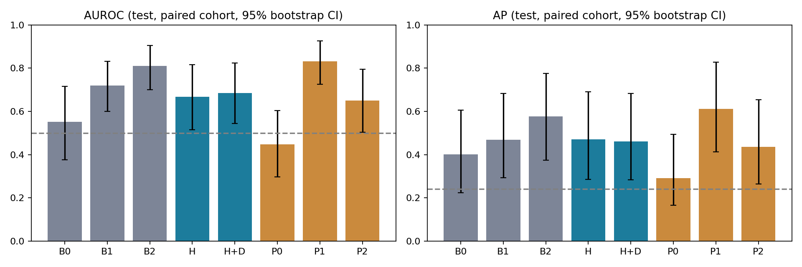

# YAICON ErrorProbe 실험 결과 보고서

## 질문과 방법

Frozen Qwen2.5-1.5B-Instruct의 자연 생성 답변에서 최종 숫자 정답 여부(오답=1)를 예측했다. GSM8K 공식 train pool에서 seed 42로 중복 질문을 묶고 pilot 50개 및 별도 train 300 / validation 100 / test 100개를 생성 전에 고정했다. 모델은 학습하지 않았고 probe만 학습했다.

실제 호스트: coder-minseongu-yaicon-9th-errorprobe. 실제 GPU: Tesla V100-SXM2-32GB (사전 안내의 RTX3090과 다름). FP16, greedy, batch=1, max_new_tokens=512. 모델 revision `989aa7980e4cf806f80c7fef2b1adb7bc71aa306`, 데이터 revision `740312add88f781978c0658806c59bc2815b9866`.

## 실제 실행 및 검증

- Pilot 50개: 정답 28, 오답 22, parsing 실패 10, alignment 실패 0.
- Main 500개 실제 생성. 실패한 최종 답 추출은 전체 accuracy에서 오답으로 계산했다.
- P1 full-sequence/prefix 수치 일치 검증 5개 통과. 모든 선택 block의 relative L2 <0.01, cosine >0.999.
- 원본 생성 ID로 teacher forcing을 수행했다. token t의 NLL은 t-1 logits에서 구했다. roundtrip ID 일치를 확인한 경우에만 재tokenize offset을 정렬에 사용했으며 모델 입력 ID를 교체하지 않았다.

## 표본 구성

|평가 집합|split|N|정답|오답|오류율|
|---|---|---:|---:|---:|---:|
|all|train|300|178|122|0.407|
|all|validation|100|56|44|0.440|
|all|test|100|60|40|0.400|
|common|train|219|178|41|0.187|
|common|validation|75|56|19|0.253|
|common|test|79|60|19|0.241|

공통 feature 비교에서 제외한 사례: 127개. 개별 이유는 cohort_counts.json에 기록했다. 전체 answer accuracy는 0.588.

## 고정 test 결과

AP는 average_precision_score이며 PR-AUC의 사다리꼴 적분과 혼용하지 않는다. Recall@20%는 예측 위험도 상위 ceil(0.2×N)개를 검토할 때 발견되는 전체 오답의 비율이다.

|집합|모델|N|layer|C|AUROC|AP|오류율|Recall@20%|
|---|---|---:|---:|---:|---:|---:|---:|---:|
|common|B0|79|-|0.01|0.552|0.401|0.241|0.316|
|common|B1|79|-|0.1|0.720|0.469|0.241|0.368|
|common|B2|79|-|0.1|0.810|0.577|0.241|0.421|
|common|H|79|14|10.0|0.668|0.470|0.241|0.421|
|common|H+D|79|14|1.0|0.685|0.461|0.241|0.368|
|common|P0|79|14|10.0|0.447|0.292|0.241|0.211|
|common|P1|79|14|0.01|0.832|0.611|0.241|0.526|
|common|P2|79|14|1.0|0.650|0.436|0.241|0.316|
|all|B0|100|-|0.01|0.793|0.826|0.400|0.500|
|all|B1|100|-|0.1|0.865|0.862|0.400|0.500|
|all|P0|100|21|0.01|0.560|0.569|0.400|0.275|

B0=외형 통제, B1=B0+전체 mean NLL, B2=B1+숫자/연산자/최종 답/step confidence, H=B2+P2 hidden, H+D=H+18개 block 변화량. P0/P1/P2는 hidden-only이며 미래 통제 변수나 confidence를 넣지 않았다.

## 주요 차이와 불확실성

동일 test 행을 재표집한 paired bootstrap 2,000회 중 유효 2000회. 단일 class 재표집은 제외했다. 아래는 AUROC 차이 및 95% percentile CI다. 선택된 모델은 bootstrap에서 고정되므로 재학습/모델 선택 불확실성은 반영하지 않는다. 여러 비교에 대한 다중검정 보정은 하지 않았으며 확인적 유의성 판정으로 사용하지 않는다.

- B1 minus B0: +0.168 [-0.013, +0.347]
- B2 minus B1: +0.089 [-0.006, +0.189]
- H minus B2: -0.141 [-0.302, +0.031]
- H+D minus H: +0.017 [-0.015, +0.052]
- P1 minus P0: +0.384 [+0.216, +0.553]
- P2 minus P1: -0.182 [-0.327, -0.040]

## Label shuffle sanity check

train/validation label을 각각 섞은 뒤 동일한 layer/C 선택 절차를 20회 반복하고 원래 test label로 평가했다.

- B2: 평균 AUROC 0.464, 평균 AP 0.307.
- H: 평균 AUROC 0.512, 평균 AP 0.291.

## 결과 해석

이번 공통 test에서 B2(숫자 등 confidence까지 포함)는 AUROC 0.810, AP 0.577, Recall@20% 0.421이었다. P2 hidden을 추가한 H의 점추정은 더 낮았지만 H−B2의 AUROC 차이 CI가 0을 포함하므로 악화 자체를 확정하지 않는다. P2 hidden과 block 변화량의 **추가 이득은 이번 실험에서 확인되지 않았다**. B2−B1의 CI도 0을 포함하므로 숫자 confidence의 개선 역시 재현 검증이 필요하다.

P1 hidden-only는 AUROC 0.832, AP 0.611, Recall@20% 0.526이었다. P1−P0 AUROC 차이는 +0.384 [0.216, 0.553]으로 이 표본에서는 생성 후 reasoning을 거친 상태의 신호가 관찰됐다. 다만 P1 위치는 사후 정의되며, P1의 B2 대비 우월성을 입증한 분석은 아니다. P2−P1 AUROC 차이는 −0.182 [−0.327, −0.040]이었다. 이 결과는 추가 seed 및 별도 test에서 우선 재검증할 탐색적 후보로 해석한다. test 결과를 본 후 layer/C/feature를 재선택하지 않았다.

## Confidence 구간별 탐색 분석

train의 전체 response mean NLL 삼분위 경계(0.1693, 0.2317)를 고정한 뒤 test에 적용했다. NLL이 낮을수록 모델 token confidence가 높다. 아래 분석은 사후 탐색이며 작은 오답 수 때문에 구간별 우열을 확정하지 않는다.

|NLL 구간|test N|오답 수|B2 AUROC|H AUROC|
|---|---:|---:|---:|---:|
|낮음 (<0.1693)|22|3|0.860|0.860|
|중간 (0.1693–0.2317)|31|6|0.807|0.560|
|높음 (≥0.2317)|26|10|0.713|0.606|

낮은 NLL 구간은 오답이 3개뿐이다. 세 구간의 AUROC에서 H가 B2보다 높은 경우는 없었으며, 이번 탐색은 P2 hidden의 독립적 이득을 지지하지 않는다. 구간별 AP와 Recall은 exploratory_confidence_bins.json에 보존했다.

## 해석의 범위와 한계

B2/H/H+D는 답변 완료 후 탐지다. P0는 생성 직전 prompt 마지막 token, P1은 최종 숫자의 첫 token 직전, P2는 최종 숫자 마지막 token을 본 상태다. P1 위치는 사후 최종 답 span으로 정의되며 reasoning 이후일 수 있다. 따라서 P1을 “생각하기 전 오류 탐지”로 해석하지 않는다.

선택된 block 7→14, 14→21, 21→28 변화량이며 인접 block 변화량이 아니다. 모든 layer는 final normalization 이전 raw block output이다. 숫자 최종 정답 label은 reasoning 과정의 무오류를 보장하지 않는다. 자연 오답만 사용했으며 인위적 오류 trajectory, 외부 verifier 비교, fine-tuning은 수행하지 않았다.

500개/test 100개 규모의 탐색 실험이다. hidden vector의 차원이 train 수보다 커 과적합 가능성이 있다. validation에서만 layer와 C를 선택했고 test를 보고 재선택하지 않았다. parser는 고정된 decimal 한 줄 형식만 허용하여 수학적으로 같은 답도 형식 위반이면 parsing 실패가 될 수 있다. confidence가 비슷한 구간에서의 결과는 train NLL 삼분위 경계를 쓴 소규모 사후 탐색이며 exploratory_confidence_bins.json에 별도 기록했다.

## 다음 실험

다른 seed와 더 큰 held-out test에서 차이의 재현성을 검증하고 hidden 고차원 probe의 정규화/PCA를 train-only 절차로 비교한다. FinQA, 오류 유형 분류, recovery routing, logit lens, perturbation은 후속 범위다.

## 실제 사례

### gsm8k_train_6378 — label=1, H 위험도=1.000

All 20 of Grant’s baby teeth have fallen out and he has a total of $54 from the tooth fairy. Every time he lost a tooth, he put it under his pillow for the tooth fairy, except for one that he dropped on the way home from school and another he swallowed accidentally. The tooth fairy left Grant $20 when he lost his first tooth. How much did the tooth fairy leave him per tooth after his first tooth, assuming equal money exchanged for each tooth thereafter?

Gold: 2, prediction: 1.79

```text
Reasoning:
Let's denote the amount of money the tooth fairy leaves per tooth after the first as \( x \).

Grant had 19 teeth remaining after losing his first tooth. So, we need to account for the money from these 19 teeth plus the initial $20 for the first tooth.

Total money = Money from first tooth + (Money per tooth * Number of remaining teeth)
$54 = $20 + ($x * 19)

Now let's solve for \( x \):

$34 = $x * 19
$x = $34 / 19
$x ≈ $1.79

Final answer: 1.79
```

### gsm8k_train_1025 — label=1, H 위험도=0.000

A survey conducted by the school showed that only 20% of the 800 parents agree to a tuition fee increase. How many parents disagree with the tuition fee increase?

Gold: 6.4E+2, prediction: 4.8E+2

```text
Reasoning:
First, calculate the total number of parents who agreed to the tuition fee increase. This is given as 20% of 800.
\[ \text{Agree} = 0.20 \times 800 \]
Next, subtract the number of parents who agreed from the total number of parents to find out how many disagree.
\[ \text{Disagree} = 800 - \text{Agree} \]

Final answer: 480
```

### gsm8k_train_2155 — label=0, H 위험도=1.000

Tilly needs to sell 100 bags at $10 per bag to make $300 in profit. How much did she buy each bag for?

Gold: 7, prediction: 7

```text
To find out how much Tilly bought each bag for, we need to calculate her total cost and then divide it by the number of bags sold.
First, let's calculate her total revenue from selling 100 bags at $10 per bag:
Total Revenue = Number of Bags × Price per Bag
Total Revenue = 100 × $10 = $1000

Now, we know that her goal is to make a $300 profit on these sales. So, her total earnings (including profit) should equal her total revenue plus her desired profit:
Total Earnings = Total Revenue + Desired Profit
$300 = $1000 + $300

Next, we can subtract her desired profit from her total revenue to find out how much she spent on buying the bags:
Total Cost = Total Revenue - Desired Profit
Total Cost = $1000 - $300 = $700

Finally, we can divide the total cost by the number of bags to find out how much she bought each bag for:
Cost Per Bag = Total Cost ÷ Number of Bags
Cost Per Bag = $700 ÷ 100 = $7

Therefore, Tilly bought each bag for $7.

Final answer: $7.00
```

### gsm8k_train_2812 — label=0, H 위험도=0.000

A magazine costs $3 each. Jewel bought 10 magazines to be sold at $3.50 each. How much will be Jewel gain from selling these?

Gold: 5, prediction: 5

```text
To calculate the gain, we first need to determine the total cost of buying the magazines and then subtract it from the total revenue from selling them.

Total cost = Number of magazines * Cost per magazine
           = 10 * $3
           = $30

Total revenue = Number of magazines * Selling price per magazine
              = 10 * $3.50
              = $35

Gain = Total revenue - Total cost
     = $35 - $30
     = $5

Final answer: 5.0
```



## 실행 중 복구 및 해석 주의

초기 홈 디스크 부족은 pip/code-server 및 VS Code 다운로드 캐시를 /tmp에 보존 이동하고 symlink를 남겨 해결했다. 초기 FP16 eager attention의 NaN 실패 후 FP16 가중치를 유지한 SDPA math backend로 복구했다. 이전 run의 pilot 7개는 출력 형식 디버깅용이며 이 보고서의 표본에 포함하지 않는다. parser를 완화하지 않고 prompt의 plain-text 형식 지시를 명확히 한 뒤 같은 pilot 50개를 다시 생성하고 본 실험에도 동일하게 적용했다. 모든 초기 시도는 ../20261009T0535Z에 보존했다.

형식 추출 실패를 오답 처리하므로 all 집합의 B0/B1은 format_success 변수로 형식 실패를 쉽게 탐지할 수 있다. 이 성능을 산술적 오답 탐지 능력만으로 해석하면 안 된다. 공통 집합 비교는 최종 답 span을 확보한 사례로 제한되므로 전체 생성 분포에 그대로 일반화할 수 없다.

## 완료 범위와 재실행

요청된 환경 확인, pilot 50개, main 500개, feature 추출, validation 선택, test 평가, paired bootstrap, label-shuffle, 그래프, 실제 사례 4개 및 한국어 회의 요약을 완료했다. 최종 run의 실행 오류는 0건이며 main 형식 parsing 실패 127개는 삭제하거나 재표집하지 않았다. 초기 수치 안정성 실패 및 별도 컴파일 진단 실패는 복구 이력에 보존했다. FinQA 등은 지시문에서 정한 후속 범위다.

재실행: [README](README.md), [환경 복구](setup.sh), [버전 lock](requirements-lock.txt). 결과표: [전체 비교](comparison.csv), [baseline 비교](baseline_comparison.csv), [P0/P1/P2 비교](hidden_timepoint_comparison.csv), [신뢰구간](metric_intervals.csv). [최종 검증](audit.json)을 통과했고 홈 여유 공간은 1GiB 이상이다. 보고서만 다시 만들 때는 저장된 평가 결과로 experiment.report를 실행한 뒤 finalize_report.py를 실행한다.
