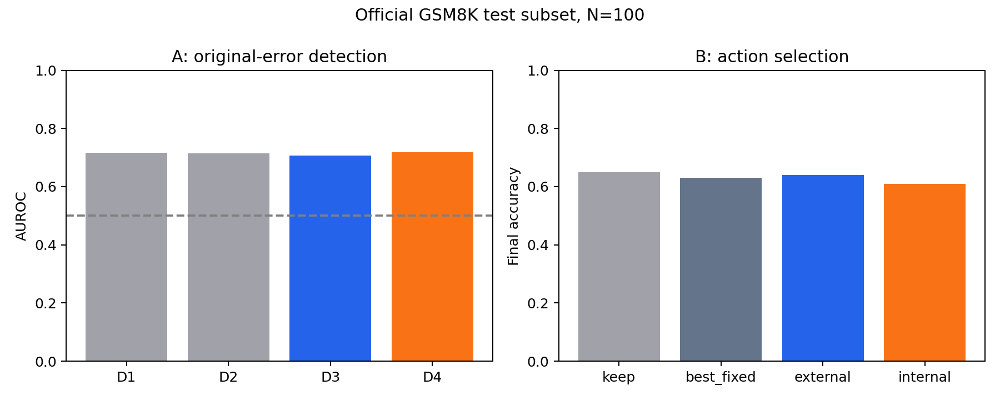
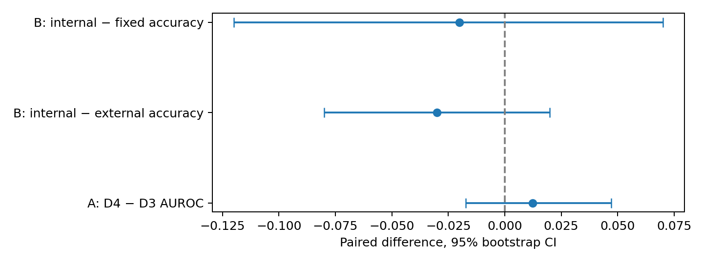

# GSM8K Experiments A and B — completed exploratory run

Completed on 2026-10-12 20:45 KST. Experiment C was not run.

## Main findings

A: D3 external AUROC was **0.707**; D4 with hidden states was **0.719**. The paired difference was **+0.012**, 95% bootstrap CI [-0.017, +0.047]. This is an exploratory, conditional-on-training comparison, not a general claim about hidden states.

B: external selection reached **64.0%**, internal selection **61.0%**, and the validation-selected fixed policy (Rebuild) **63.0%**. Internal minus external was **-3.0 percentage points**, CI [-8.0, +2.0]. B was run independently of A's findings.

Neither primary hidden-state gain is established by this run: both paired intervals include zero. B’s internal selector also has lower point accuracy and more harmful revisions than its external counterpart.

## Cohorts and provenance

| Split | N | Correct originals | Errors | Calculator available | Truncated originals |
| --- | --- | --- | --- | --- | --- |
| pilot | 40 | 29 | 11 | 13 | 0 |
| train | 200 | 159 | 41 | 60 | 1 |
| validation | 80 | 59 | 21 | 23 | 0 |
| test | 100 | 65 | 35 | 35 | 0 |

Pilot, train, and validation come from official GSM8K train. Final evaluation uses a fixed 100-example subset of official GSM8K test, never the old train-derived test. The pilot is excluded from all fitting and evaluation. Exact normalized question duplicates stay together; no reliable paraphrase/family IDs are available. All methods use the same records and pre-repair features. No examples were resampled based on correctness.

Model: `Qwen/Qwen2.5-1.5B-Instruct` at `989aa7980e4cf806f80c7fef2b1adb7bc71aa306`. Dataset: `openai/gsm8k` (`main`) at `740312add88f781978c0658806c59bc2815b9866`. Seed: 20261012. Original/repair generation: greedy with inherited repetition penalty 1.1, 512 new tokens maximum. Verification: up to 8 tokens, exact CORRECT/INCORRECT parsing. Frozen LLM; only small logistic classifiers and training-only preprocessing are fit.

The local prior run supplies 320 original responses (40 pilot + 200 train + 80 validation), their original token IDs and generation NLL. All old results remain unchanged. The 100 official-test originals are newly generated once. New verification features and independent repairs are collected for all 420 examples. The current GPU is GTX 1080 Ti 11 GB. New inference is FP32; cached original responses were FP16 on V100. The precision difference and reused training responses limit train/test comparability.

The team's meeting PDF also uses Qwen2.5-1.5B-Instruct and greedy decoding, but a different #### prompt, 1,024-token originals, 800/200 train/validation and the full 1,319-example test set. This run aligns the model family and decoding, while retaining the older local 512-token prompt to reuse originals. It is not a controlled replication of the team's numerical results.

## Pilot and implementation checks

Final pilot: 29 correct and 11 incorrect originals; 3 errors were repairable by at least one action; oracle 32/40. Calculator availability 13/40. All 40 verifier outputs parsed. All 36 prefix-vs-full hidden comparisons passed (maximum relative L2 2e-06). Peak allocated memory 7.72 GB; reserved 8.48 GB. Corrected pilot collection cost 218.4 seconds, excluding initial debug work and historical original generation.

Pilot debugging found and fixed (1) BPE merging the newline boundary with final response punctuation; (2) credit for unfinished repairs under a 256-token cap, leading to a 512-token cap and rejection of truncated fallback answers; (3) last-number extraction choosing an incidental quantity after the answer. The concluding-clause correction was based on pilot example gsm8k_train_3784 and changed only that pilot label; already collected main records were rescored before fitting. Debug outputs, previous labels, and protocol amendments are retained.

Scoring prefers explicit final markers, numeric boxed answers, then a numeric complement of a concluding verb on the final nonempty line, then a last-number fallback. Truncated responses need an explicit final marker or boxed answer. Exact Decimal equality normalizes dollar signs, commas, and decimals; percentages remain in question units, with no gold-based rounding. This is final numeric answer scoring, not a judgment that every reasoning step is correct.

## A: incorrect-original detection

| Detector | AUROC | Error AP | Brier | Top-20% error recall | FPR at 0.5 |
| --- | --- | --- | --- | --- | --- |
| D1 | 0.717 | 0.645 | 0.191 | 40.0% | 4.6% |
| D2 | 0.715 | 0.646 | 0.199 | 40.0% | 6.2% |
| D3 | 0.707 | 0.650 | 0.199 | 40.0% | 9.2% |
| D4 | 0.719 | 0.647 | 0.201 | 40.0% | 12.3% |
| verdict_only | 0.521 | 0.360 | 0.520 | 14.3% | 61.5% |

Test error prevalence is 35.0%; this is the no-skill AP reference. AP is average precision, not trapezoidal PR-AUC. The 0.5 threshold and top-20% review fraction are fixed in advance.

D1: original mean raw-model token NLL + log token length. NLL is teacher-forced at the preceding logit position and excludes special tokens; it is not the repetition-penalized decoding-score probability. D2: D1 + train-fit question/response TF-IDF (up to 1,500 unigram/bigram terms). D3: D2 + explicit verifier judgment indicators and mean generated-verdict token NLL. D4: D3 + one selected 1,536-dimensional hidden vector. The lexical text baseline is modest; this does not compare against every external semantic detector.

| Model | Selected hidden vector | C | Validation AUROC |
| --- | --- | --- | --- |
| D1 | none | 0.1 | 0.826 |
| D2 | none | 1.0 | 0.836 |
| D3 | none | 1.0 | 0.835 |
| D4 | preverdict_L14 | 1.0 | 0.882 |

Hidden candidates: last completed-response token (possibly punctuation), dedicated two-newline boundary token, final verification-prompt token before generating any verdict; raw outputs of blocks 7/14/21/28, before final model normalization. Exact token IDs/offsets are saved per record. Segmented verification encoding guarantees a distinct separator token and is reused unchanged for verdict generation. All 12 vectors are retained for later work. Only one vector is added per candidate detector, with training-only coordinate scaling and division by sqrt(1536).

Validation-only label shuffle sanity check (20 fits at frozen selected settings): D3 mean AUROC 0.486, range 0.265–0.799; D4 mean 0.501, range 0.307–0.734. These are sanity checks, not test-set tuning.

## B: selecting independent actions

| Policy | Accuracy | Errors repaired | Repair rate among errors | Correct answers harmed | Harm rate among correct |
| --- | --- | --- | --- | --- | --- |
| external | 64.0% | 2 | 5.7% | 3 | 4.6% |
| internal | 61.0% | 1 | 2.9% | 5 | 7.7% |
| keep | 65.0% | 0 | 0.0% | 0 | 0.0% |
| best_fixed | 63.0% | 12 | 34.3% | 14 | 21.5% |
| best_fixed_repair | 63.0% | 12 | 34.3% | 14 | 21.5% |

The best fixed policy selected on validation is **Rebuild**; the best fixed repair excluding Keep is **Rebuild**. Validation fixed accuracies: Keep 73.8%, Recalculate 73.8%, Rebuild 75.0%, Review 73.8%. Unavailable Recalculate falls back to Keep in fixed-policy evaluation.

| Selector | Hidden vector | C | Validation final accuracy | Test action counts |
| --- | --- | --- | --- | --- |
| external | none | 0.1 | 78.8% | {'Keep': 9, 'Recalculate': 6, 'Rebuild': 17, 'Review': 68} |
| internal | boundary_L28 | 1.0 | 80.0% | {'Keep': 17, 'Recalculate': 15, 'Rebuild': 21, 'Review': 47} |

Four independent binary heads predict [Keep, Recalculate, Rebuild, Review] success; multiple actions may succeed. Keep = 1 − A error label is checked for every example. Missing calculator outcomes are excluded from that head’s fitting and masked at decision time. A constant fallback handles single-class heads. Inputs contain question/response text, generation and verification measurements, plus hidden states for the internal version. No gold answers, reference reasoning, observed repair output, or success label enters prediction.

Recalculate uses a conservative safe Decimal calculator on an explicit numeric equality whose RHS matches the model’s own extracted final answer. Symbolic or unreliable extraction is unavailable. Rebuild sees only the original question; Review sees the question and original response. Repairs never receive another repair’s result. Selection uses only pre-repair features and availability.

| Split | Best fixed accuracy | Oracle action accuracy | Potential gain | Repairable errors |
| --- | --- | --- | --- | --- |
| train | 83.0% | 92.5% | 9.5 pp | 26 |
| validation | 75.0% | 86.2% | 11.3 pp | 10 |

The oracle is a diagnostic upper bound using observed outcomes, not a deployable selector. Its train/validation advantage measures whether action choice has any opportunity to help; a learned selector must find that opportunity without seeing outcomes.

## Paired uncertainty

| Difference | Point estimate | 95% bootstrap interval | Valid resamples |
| --- | --- | --- | --- |
| A_D4_minus_D3_AUROC | +0.0123 | [-0.0174, +0.0471] | 2000 |
| A_D4_minus_D3_AP | -0.0025 | [-0.0480, +0.0375] | 2000 |
| B_internal_minus_external | -0.0300 | [-0.0800, +0.0200] | 2000 |
| B_internal_minus_best_fixed | -0.0200 | [-0.1200, +0.0700] | 2000 |
| B_external_minus_best_fixed | +0.0100 | [-0.0800, +0.1100] | 2000 |
| B_internal_minus_keep | -0.0400 | [-0.0900, +0.0100] | 2000 |

2,000 paired question-level bootstrap resamples with seed 20261013. AUROC/AP resamples lacking both classes are excluded. Intervals condition on the trained models and chosen sample; they do not include retraining or hyperparameter-selection variability. The 100-example test set has coarse accuracy resolution and broad uncertainty.

## Compute and storage

| Split | N | New original generation (s) | Verifier generation (s) | Hidden pass (s) | All repairs (s) | Collection wall (s) |
| --- | --- | --- | --- | --- | --- | --- |
| pilot | 40 | 0.0 | 9.9 | 6.8 | 191.1 | 218.4 |
| train | 200 | 0.0 | 47.1 | 31.7 | 715.3 | 831.7 |
| validation | 80 | 0.0 | 19.5 | 13.1 | 286.4 | 336.0 |
| test | 100 | 683.1 | 24.5 | 16.5 | 386.7 | 1149.4 |

Small-model training and validation search took 12.7 seconds on CPU. CPU feature transformation plus prediction over 100 test examples: D1 0.002s, D2 0.040s, D3 0.040s, D4 0.112s, external 0.042s, internal 0.104s.

Offline data collection evaluates both generative repairs for every example to obtain independent labels. Applying a frozen selector needs only original-response features, initial verification, any selected hidden pass, CPU prediction, and one chosen repair. Fixed policies do not require verification. Batched repair wall time is apportioned across examples and measures throughput, not one-request latency. Historical cached-original generation, dependency installation, downloads, interrupted/debug passes, and model-loading time are excluded from the main stage totals. Verifier confidence teacher forcing is included in collection wall time but not separately timed.

| Policy | Selected repair time on test (s, batch-amortized) | Selected repair tokens |
| --- | --- | --- |
| external | 164.4 | 10241 |
| internal | 134.0 | 9181 |
| keep | 0.0 | 0 |
| best_fixed | 193.3 | 23378 |
| best_fixed_repair | 193.3 | 23378 |

Peak allocated GPU memory across all phases was 8.18 GB; peak reserved memory was 10.90 GB. Recorded collection time totals 42.3 minutes, including the corrected pilot.

Persistent artifacts include small hidden arrays and text/token records; full vocabulary logits and all-layer activations are not retained. Large weights and the rebuilt environment are under `/tmp/yaicon-ab`; they can disappear when the container restarts. `storage.json` records final usage and free space.

Batch-one deployment timing: mean seconds over six excluded pilot questions, model already loaded and original response/NLL already available. This is a latency benchmark, not an accuracy evaluation.

| Selector | Verification | Extra hidden pass | CPU classifier | Selected repair | Total |
| --- | --- | --- | --- | --- | --- |
| external | 0.543 | 0.000 | 0.003 | 4.864 | 5.410 |
| internal | 0.543 | 0.205 | 0.004 | 6.359 | 7.110 |

## Sensitivity and limitations

Under strict Final answer: <number> formatting, original accuracy is 50.0%; with choices held fixed, external selector accuracy is 42.0% and internal is 46.0%. Strict-label D3/D4 AUROC are 0.664/0.683. This is a rescoring sensitivity analysis, not a second tuned experiment.

Remaining limitations: modest train/validation size, 100-test subset, one model and one data/split seed, lexical text representation, a mean-NLL confidence baseline (not every richer confidence/entropy control), conservative calculator coverage, residual rule-based extraction errors, token-budget failures, validation selection over 12 hidden candidates, and training/test inference precision differences. Cached original responses may contain benchmark contamination inherited from model pretraining. Results concern natural generated final-answer errors, not error types or step-level causal mechanisms. Negative findings should not be generalized to larger samples or other models.

## Artifacts and reproduction

- Runnable code and detailed protocol: `../../experiments/ab/README.md`.
- Resumption: `bash experiments/ab/run.sh` from repository root.
- Settings and split IDs: `config.json`, `manifest.json`, `protocol_frozen.json`.
- Source specification and team reference: `source_notion.txt`, `team_reference.txt`.
- Pilot checks and debug history: `pilot_audit.json`, `pilot_integrity.json`, `pilot_debug_v1/`, `pilot_conclusion_fix.json`.
- Raw inference and reusable features: `stages/`, `records/`, `hidden/`.
- Training/validation: `trained.joblib`, `selection_frozen.json`, `validation_grid.json`, `repair_opportunity.json`.
- Final results: `test_results.json`, `test_predictions.json`, `strict_format_sensitivity.json`, `integrity_audit.json`.
- Human-readable examples: `examples.json`; figures: `results.png`, `paired_differences.png`.
- Experiment C is deferred; no C variants, C training, or C results are claimed.

## Storage snapshot

Persistent run artifacts occupy approximately 53.1 MB; workspace free space is 103.1 GB. Temporary environment/cache usage: 9.2G	/tmp/yaicon-ab. Previous results were preserved.

## Observed dataset reference inconsistency

A non-exhaustive qualitative review found an erroneous official reference for `gsm8k_test_823`: Sasha scored 14 in the first game and 10−6=4 in the second, totaling 18. The reference mistakenly adds Julie’s first-game 10 instead and gives 14. The model’s 18 is counted as an error by official-reference scoring. Primary labels, models, and choices are unchanged.

Excluding only this flagged example (post-hoc sensitivity, N=99), D3/D4 AUROC are 0.711/0.722; external/internal policy accuracy is 64.6%/61.6%, Keep 65.7%, and the fixed policy 63.6%. See reference_quality.json. This does not certify the other references as error-free.

## Figures

## Validation comparison by hidden position

| Experiment | Position | Layer/C | Validation metric |
| --- | --- | --- | --- |
| A | answer | answer_L7 / 1.0 | 0.845 |
| B | answer | answer_L14 / 0.1 | 0.775 |
| A | boundary | boundary_L21 / 1.0 | 0.876 |
| B | boundary | boundary_L28 / 1.0 | 0.800 |
| A | preverdict | preverdict_L14 / 1.0 | 0.882 |
| B | preverdict | preverdict_L28 / 0.01 | 0.787 |

These are validation-selected comparisons, not additional independent test results. The primary official-test comparison uses only the globally selected vector for each experiment.
