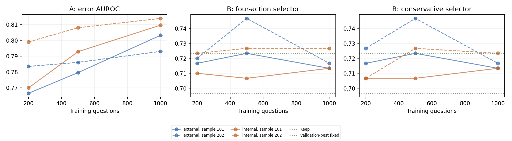
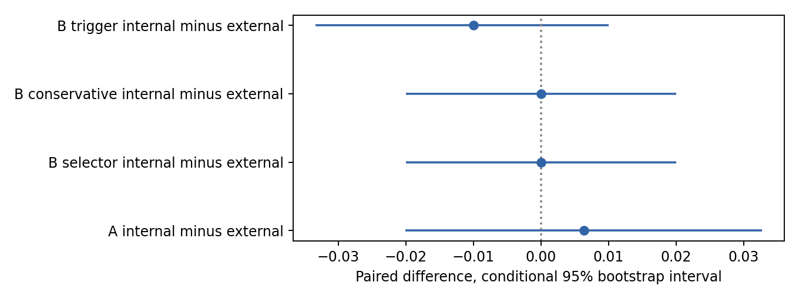

# GSM8K AI Endoscope follow-up

Completed follow-up: frozen Qwen2.5-1.5B-Instruct; GSM8K; 1200 training-pool, 200 development, and 300 fresh official-test questions. Experiment C, FinQA, larger models and activation steering remain deferred.

## Main confirmatory comparison

At the predeclared primary setting (1,000 training questions, sample seed 101), strengthened external A AUROC is **0.803** and selected internal AUROC is **0.810**. Internal−external: **+0.006 [-0.020, +0.033]**.

The primary external and internal B selectors both achieve **71.3%**, versus **69.7%** Keep and **72.3%** validation-selected Review. Their paired internal−external difference is **+0.000 [-0.020, +0.020]**. Neither action-specific selection over error-triggered repair nor a hidden-state advantage is established by these intervals.

These are conditional question-bootstrap intervals, not uncertainty over model pretraining, all possible training samples, or method selection. The second training sample and learning curves are stability checks, not grounds for replacing the primary result. No follow-up method is selected from fresh-test results.

## What the original run explains

The original 100-test records support an oracle of 79%, versus 65% Keep. Rebuild repaired 12 errors and damaged 14 correct answers; Review repaired four, damaged one, and preserved the final answer on 89/100 examples. Only two errors were repaired by both; Rebuild had ten unique repairs, Review two, calculator none. External/internal selectors missed 12/13 of 14 repairable errors. An oracle uses observed outcomes and is not achievable selector performance.

The Keep/Review probability correlations were 0.993/0.968 on validation and 0.996/0.979 on test (external/internal). Small success margins drove 91/83 interventions on 100 questions. The original validation fixed-action winner exceeded Keep by one question; bootstrap re-selection chose Keep 34.2%, Rebuild 50.1%, Review 15.8% of the time (Keep-first ties). This supports weak action discrimination and unstable small-sample decisions; it does not prove hidden states contain no information.

A 36-response stratified qualitative audit found two apparent harmful revisions caused by extraction errors, alongside genuine reasoning mistakes and formatting differences. V2 changes seven old correctness labels (five train, two old test); the old run is immutable. With the old choices frozen, V2 old-test accuracy becomes external 65%, internal 62%, fixed Rebuild 65%, Keep 65%. Full adjudications, all 15 changed extractions, transition counts, overlaps, probabilities, and error examples are saved in SCORING_AUDIT.md, DIAGNOSTICS.md, ERROR_CASES.md and their JSON files. These analyses remain exploratory and separate from the new test.

## Protocol and measurement changes

Model revision `989aa7980e4cf806f80c7fef2b1adb7bc71aa306`; GSM8K revision `740312add88f781978c0658806c59bc2815b9866`. Every follow-up response is newly generated once in FP32 on GTX 1080 Ti because reused historical originals were FP16. Compatible code, prompts, tokenizer/model/dataset revisions, calculator, and diagnostic artifacts are reused. All previous local question hashes are excluded; exact duplicates remain together, but no paraphrase-family IDs exist. The new official-test subset excludes the old 100 and was not generated until every model and policy was frozen.

Greedy decoding, inherited repetition penalty 1.1, 512-token originals and repairs, 8-token verdicts; identical prompts across follow-up splits. Main original batch16, mixed independent repair batch32; final partial batches are smaller. The resource pilot used batch8/16; a larger-batch check reproduced 16/16 original texts, peak9.93GB. All model parameters remain frozen. Original question/response, verification features and hidden arrays are shared across A and B. References and observed outcomes are never prediction inputs.

Numerical scoring v3 preserves numeric final markers/boxes, recognizes final-answer-is and next-line answers, prefers explicit numerical predicates in prose final-answer lines, rejects nonnumeric refusals and unresolved symbolic expressions, then retains last-number fallback. A pre-fit training-only audit found v2 regressions: 312 intermediate records were archived, four repair labels corrected, and one original span re-extracted without regenerating original or repair responses. No fresh-test outcome existed at amendment time. All reference-free extracted spans are saved. Known limitations include contextual numbers in prose and symbolic final expressions; legacy and strict-format scores are retained as sensitivities. No calculator rule was expanded. A error label=1 means incorrect; B Keep success=1−A error, with four independent success labels and unavailable calculator masking.

CORRECT tokenizes as [COR, RECT], INCORRECT as [INC, OR, RECT]. Both complete label strings are teacher-forced from the identical segmented pre-verdict prompt. Features include both summed raw log probabilities and their two-label normalized probability, without length normalization or EOS. Generated verdict NLL and judgment indicators are retained. Numeric-token confidence averages/maximizes raw causal NLL at all tokens overlapping the extracted answer span; whole-response confidence and response length remain shared controls. Calculator eligibility is also an explicit shared scalar, computed from the original response without a reference or success label, in addition to masking unavailable actions. This pre-fit control amendment is recorded separately. Token IDs, offsets and positions are saved.

Hidden positions are the last token overlapping the actual extracted numerical answer, the dedicated response boundary, and the last pre-verdict prompt token, all in the same verification context at raw block14 output before final normalization. They are not hidden states from the original generation context. Missing numerical answers get a zero hidden vector and a shared missingness indicator. Pilot full/prefix checks confirm causality before verdict generation. Fixed layer14 limits the follow-up search; this does not rule out information in other layers.

A compares D1 confidence/length, D2 plus train-fit TF-IDF, D3 plus the old verifier controls, the strengthened external baseline, and nine internal combinations (three positions × three representations). Representations: train-only coordinate standardization /sqrt(1536), coordinate standardization alone, or training-fit PCA32 on standardized hidden coordinates (no whitening). C∈{0.01,0.1,1} for each. The original shrinkage yields mean hidden norm≈1 versus≈38 without shrinkage, equivalent to a 1536-fold hidden coefficient penalty at fixed shared-feature scale. The old selected A model already had a nontrivial hidden logit contribution on validation (SD0.392, versus1.087 for generation controls and0.570 for verifier controls), so shrinkage did not simply erase the hidden signal. These correlated contributions are descriptive, not causal importance estimates. Removing it also changes the relative regularization of shared features: this is a joint representation/regularization comparison, not a pure information test.

Two deterministic permutations of a 1,200-question pool give nested subsets of 200, 500 and 1,000; each has its own train-only TF-IDF, scaler, PCA and classifiers. A chooses validation AUROC. B independently selects four success heads by mean available-head validation log loss, then evaluates argmax selection and a margin policy. The detector-trigger policy uses a train-fitted A detector; repair action and threshold are selected jointly on held-out development. There is no in-sample stacking. Before any classifier fitting or validation predictions, the trigger grid was amended from coarse quarter steps to 0.0–0.9 deciles plus a Keep-only1.01 threshold, equally for both variants; the training-only rationale and prior grid are retained in trigger_grid_amendment.json. Conservative margins are selected on development, ties favor fewer interventions, and the grid includes Keep-only. This changes B’s old accuracy-based head selection to a proper probability score; the same four-action architecture remains.

## Cohorts and feasibility

| Split | N | Correct | Errors | Repairable errors | Oracle | Calculator available | Numeric span | Truncated originals |
| --- | --- | --- | --- | --- | --- | --- | --- | --- |
| pilot | 40 | 24 | 16 | 8 | 0.800 | 16 | 40 | 0 |
| train | 1200 | 906 | 294 | 139 | 0.871 | 418 | 1191 | 8 |
| validation | 200 | 154 | 46 | 26 | 0.900 | 64 | 200 | 0 |
| test | 300 | 209 | 91 | 43 | 0.840 | 98 | 299 | 2 |

Review numerical-answer changes and calculator extraction failures:

| Split | Review changes / N | Calculator unavailable reasons |
| --- | --- | --- |
| pilot | 4 / 40 | {'no_explicit_final_numeric_equality': 24} |
| train | 103 / 1200 | {'no_explicit_final_numeric_equality': 774, 'no_final_answer': 8} |
| validation | 13 / 200 | {'no_explicit_final_numeric_equality': 136} |
| test | 26 / 300 | {'no_explicit_final_numeric_equality': 201, 'no_final_answer': 1} |

Training/development action-choice opportunity (observed-outcome oracle, not deployable accuracy):

| Split | Best fixed accuracy | Oracle accuracy | Oracle minus fixed |
| --- | --- | --- | --- |
| train | 0.782 | 0.871 | +0.088 |
| validation | 0.800 | 0.900 | +0.100 |

Pilot: 24 correct, 16 incorrect, 8 repairable; 278.0s, peak reserved 8.07GB. Prefix checks passed. These observations justified feasibility, not a hidden-state benefit.

## A results (primary sample)

| Candidate | Selected C | Dev AUROC | Test AUROC | AP | Brier |
| --- | --- | --- | --- | --- | --- |
| A_D1 | 1.0 | 0.7498588368153585 | 0.758 | 0.608 | 0.172 |
| A_D2 | 1.0 | 0.7600225861095427 | 0.779 | 0.644 | 0.164 |
| A_D3 | 1.0 | 0.753811405985319 | 0.809 | 0.697 | 0.152 |
| A_external | 1.0 | 0.7879728966685489 | 0.803 | 0.703 | 0.152 |
| A_numeric_L14__scaled | 1.0 | 0.8153585544889893 | 0.810 | 0.743 | 0.142 |
| A_numeric_L14__standard | 0.01 | 0.7929136081309995 | 0.806 | 0.717 | 0.158 |
| A_numeric_L14__pca32 | 1.0 | 0.7728684359119142 | 0.781 | 0.714 | 0.153 |
| A_boundary_L14__scaled | 1.0 | 0.7981366459627329 | 0.813 | 0.722 | 0.146 |
| A_boundary_L14__standard | 0.01 | 0.7850084697910784 | 0.782 | 0.671 | 0.166 |
| A_boundary_L14__pca32 | 0.1 | 0.7947487295313382 | 0.796 | 0.695 | 0.155 |
| A_preverdict_L14__scaled | 1.0 | 0.801948051948052 | 0.803 | 0.702 | 0.151 |
| A_preverdict_L14__standard | 0.01 | 0.7763975155279503 | 0.780 | 0.663 | 0.167 |
| A_preverdict_L14__pca32 | 0.1 | 0.8078769057029926 | 0.776 | 0.667 | 0.161 |
| verdict_only | — | — | 0.637 | 0.380 | 0.423 |
| candidate_probability_only | — | — | 0.687 | 0.550 | 0.277 |

Training-only PCA32 variance retained: numeric_L14: 74.1%, boundary_L14: 80.9%, preverdict_L14: 78.9%.

Validation-selected internal: `A_numeric_L14__scaled`. All individual position/representation test rows are secondary; selecting the best of this table would invalidate the confirmatory comparison.

## B results (primary sample)

| Policy | Accuracy | Repaired | Damaged | Interventions | Selected repair seconds |
| --- | --- | --- | --- | --- | --- |
| keep | 0.697 | 0 | 0 | 0 | 0.0 |
| external_selector | 0.713 | 16 | 11 | 197 | 316.4 |
| external_conservative | 0.713 | 16 | 11 | 197 | 316.4 |
| external_trigger | 0.710 | 27 | 23 | 146 | 269.7 |
| internal_selector | 0.713 | 17 | 12 | 201 | 317.8 |
| internal_conservative | 0.713 | 17 | 12 | 201 | 317.8 |
| internal_trigger | 0.700 | 26 | 25 | 146 | 271.1 |
| best_fixed | 0.723 | 11 | 3 | 300 | 554.9 |

Validation-selected policy settings:

| Variant | Error detector | Success heads | Fixed trigger repair | Error threshold | Repair-over-Keep margin |
| --- | --- | --- | --- | --- | --- |
| external | A_external | B_external | Rebuild | 0.2 | 0.0 |
| internal | A_numeric_L14__scaled | B_preverdict_L14__scaled | Rebuild | 0.2 | 0.0 |

Validation-selected fixed action: **Review**. Interventions count non-Keep action calls, including calls that preserve the final answer. Policy choices and thresholds are in selection_frozen.json. All selected repair times above are offline batch-amortized throughput costs, not single-request latency.

| Paired comparison | Difference [95% CI] |
| --- | --- |
| A_internal_minus_external | +0.006 [-0.020, +0.033] |
| B_selector_internal_minus_external | +0.000 [-0.020, +0.020] |
| external_selector_minus_keep | +0.017 [-0.017, +0.050] |
| external_selector_minus_best_fixed | -0.010 [-0.040, +0.020] |
| internal_selector_minus_keep | +0.017 [-0.020, +0.053] |
| internal_selector_minus_best_fixed | -0.010 [-0.043, +0.023] |
| B_conservative_internal_minus_external | +0.000 [-0.020, +0.020] |
| external_conservative_minus_keep | +0.017 [-0.017, +0.050] |
| external_conservative_minus_best_fixed | -0.010 [-0.040, +0.020] |
| internal_conservative_minus_keep | +0.017 [-0.020, +0.053] |
| internal_conservative_minus_best_fixed | -0.010 [-0.043, +0.023] |
| B_trigger_internal_minus_external | -0.010 [-0.033, +0.010] |
| external_trigger_minus_keep | +0.013 [-0.033, +0.060] |
| external_trigger_minus_best_fixed | -0.013 [-0.057, +0.033] |
| internal_trigger_minus_keep | +0.003 [-0.043, +0.047] |
| internal_trigger_minus_best_fixed | -0.023 [-0.067, +0.023] |
| external_selector_minus_trigger | +0.003 [-0.033, +0.037] |
| internal_selector_minus_trigger | +0.013 [-0.023, +0.047] |

Validation-selected fixed Review minus Keep: **+0.027 [+0.003, +0.050]** (same conditional paired bootstrap). This comparison concerns the fixed repair policy, not hidden-state information.

Action-specific selection should be judged against the detector-trigger policy as well as Keep and the validation-selected fixed policy. The selector−trigger rows directly measure this distinction. A conservative policy may coincide with Keep if validation supports no intervention; that is a legitimate negative result.

## Learning curves and training-sample stability

| N | Sample | Variant | A AUROC | B selector | B conservative | B trigger |
| --- | --- | --- | --- | --- | --- | --- |
| 200 | 101 | external | 0.766 | 0.717 | 0.717 | 0.713 |
| 200 | 101 | internal | 0.770 | 0.710 | 0.707 | 0.693 |
| 500 | 101 | external | 0.780 | 0.723 | 0.723 | 0.707 |
| 500 | 101 | internal | 0.793 | 0.707 | 0.707 | 0.703 |
| 1000 | 101 | external | 0.803 | 0.713 | 0.713 | 0.710 |
| 1000 | 101 | internal | 0.810 | 0.713 | 0.713 | 0.700 |
| 200 | 202 | external | 0.783 | 0.720 | 0.727 | 0.693 |
| 200 | 202 | internal | 0.799 | 0.723 | 0.707 | 0.703 |
| 500 | 202 | external | 0.786 | 0.747 | 0.747 | 0.700 |
| 500 | 202 | internal | 0.808 | 0.727 | 0.727 | 0.697 |
| 1000 | 202 | external | 0.793 | 0.717 | 0.717 | 0.710 |
| 1000 | 202 | internal | 0.814 | 0.727 | 0.723 | 0.700 |

Dashed versus solid lines denote different nested training samples. Development-selected representations and thresholds may differ with sample size. These curves describe the complete training/selection procedure, not a fixed-representation sample-efficiency law.

## Recovery and damage

Separate fixed-C=0.1 logistic probes are fit at n=1000 for action recovery among originally incorrect responses and damage among originally correct responses. They use the selected B representation and train-only preprocessing; true correctness only defines groups for fitting/evaluation. It is never a deployed input. A group predictor is deferred if either training class has fewer than20 examples. Small test groups remain descriptive, and conditional AUROC is reported only with at least two members of each class.

| Variant/action/problem | Train 0/1 | Test 0/1 | AUROC or status |
| --- | --- | --- | --- |
| external_Recalculate_recovery | 69/3 | 17/0 | Fewer than 20 training examples in one outcome class |
| external_Recalculate_damage | 276/1 | 81/0 | Fewer than 20 training examples in one outcome class |
| external_Rebuild_recovery | 143/100 | 54/37 | 0.669 |
| external_Rebuild_damage | 657/100 | 162/47 | 0.673 |
| external_Review_recovery | 210/33 | 80/11 | 0.553 |
| external_Review_damage | 747/10 | 206/3 | Fewer than 20 training examples in one outcome class |
| internal_Recalculate_recovery | 69/3 | 17/0 | Fewer than 20 training examples in one outcome class |
| internal_Recalculate_damage | 276/1 | 81/0 | Fewer than 20 training examples in one outcome class |
| internal_Rebuild_recovery | 143/100 | 54/37 | 0.668 |
| internal_Rebuild_damage | 657/100 | 162/47 | 0.687 |
| internal_Review_recovery | 210/33 | 80/11 | 0.558 |
| internal_Review_damage | 747/10 | 206/3 | Fewer than 20 training examples in one outcome class |

internal_Rebuild_recovery internal−external AUROC: -0.001 [-0.030, +0.030].

internal_Rebuild_damage internal−external AUROC: +0.014 [-0.012, +0.038].

internal_Review_recovery internal−external AUROC: +0.005 [-0.017, +0.028].

## Scoring sensitivities with choices held fixed

Strict-format success requires both the requested answer marker and a correct numerical answer. It measures a different endpoint from numerical correctness; a format failure is not automatically a mathematical error.

| Policy | V3 numeric | Legacy numeric | Strict format |
| --- | --- | --- | --- |
| keep | 0.697 | 0.693 | 0.527 |
| external_selector | 0.713 | 0.710 | 0.437 |
| external_conservative | 0.713 | 0.710 | 0.437 |
| external_trigger | 0.710 | 0.710 | 0.437 |
| internal_selector | 0.713 | 0.713 | 0.470 |
| internal_conservative | 0.713 | 0.713 | 0.470 |
| internal_trigger | 0.700 | 0.697 | 0.427 |
| best_fixed | 0.723 | 0.723 | 0.417 |

## Computation and deployment cost

| Split | Collection seconds | Original generation | Verifier generation | Hidden forward | All repairs | Peak reserved GB |
| --- | --- | --- | --- | --- | --- | --- |
| pilot | 278.0 | 66.2 | 9.8 | 6.7 | 164.1 | 8.07 |
| train | 7050.5 | 1607.0 | 285.2 | 192.3 | 4171.5 | 11.44 |
| validation | 1068.4 | 252.2 | 46.9 | 31.7 | 595.0 | 11.36 |
| test | 1868.2 | 419.0 | 72.6 | 48.3 | 1109.9 | 11.40 |

Collection totals 2.85 hours, excluding model load, interrupted work and the duplicate throughput benchmark. Training plus development search took 213.3s. Teacher-forced original/verdict confidence and both-label scoring are included in completed-group collection wall time but not separately broken out. Resumed or amended records can retain stage timings for work absent from their current per-record wall timer, so the totals are not exact end-to-end wall-clock accounting; interrupted logs and archived records are preserved. Persistent artifacts at report time occupy 154.9MB; workspace free 102.9GB.

Offline collection generates all actions for labels. A nonconstant learned deployment policy needs original confidence, verification, optional hidden features, CPU inference, and only the chosen repair. Settings that reduce to Keep or a fixed repair can bypass feature computation; the generic latency harness measures the full feature path and therefore overstates the necessary cost of those constant policies. Keep needs no repair or verification; fixed policies need only their repair. The implemented internal collector uses a separate prompt forward for hidden states; it could share work with verification scoring, but such optimized latency is not claimed. Exact CPU transform/predict timings are saved in test_results.json. Selected repair token and amortized time costs are in B_results.csv.

## Interpretation and limitations

For an available action, its success probability minus Keep success probability equals the probability of repairing an error minus the probability of damaging a correct answer. Better error detection alone therefore does not establish better action choice. The recovery/damage diagnostics examine those components separately. The original failure modes are supported by direct outcome and extraction evidence: most Review outputs preserve the old answer, independent success heads mostly track a common correctness signal, repair margins are weak, and a narrow calculator cannot undo wrong upstream reasoning. Some apparent damage was measurement error. These observations explain why repair opportunity alone did not yield selector gains; they do not establish a causal account of hidden representations.

The stronger follow-up retains the original scaling as the validation winner for primary A and B. Removing /sqrt(d) or using PCA did not establish that shrinkage caused the first run’s failure; the selected numerical-answer representation has only a small uncertain AUROC gain. A generally improves with more training data in both variants, while B accuracy is nonmonotonic and sample-dependent. The secondary sample does not replace the primary comparison. At the primary setting, zero selected margins make conservative and ordinary selectors identical. Hidden features repair one additional error but also damage one additional correct answer, leaving the same final accuracy. Error-triggered Rebuild makes more repairs and more harmful revisions; action-specific selection’s net advantage over that simpler policy remains uncertain.

On the fresh test, Review preserves the numerical answer in 274/300 cases; fixed Review repairs11 errors and damages3 correct originals. Rebuild repairs37 and damages47. The narrow calculator changes no correctness label among its98 available cases. The external/internal selectors miss27/26 of43 repairable errors. The observed-outcome oracle reaches84%, but both selectors reach71.3%; that gap is opportunity, not evidence that these features can realize it. Conditional recovery/damage probes likewise show no established hidden-state gain, and calculator predictors plus Review-damage prediction are deferred for insufficient minority examples.

Fresh-test evidence must be read through the paired intervals above. No positive hidden-state conclusion is warranted merely because one representation, sample, or policy has the largest point estimate. All tested configurations and negative findings are retained. This remains one small frozen model, one benchmark, two overlapping training samples, a lexical text baseline, and a limited representation grid. Bootstrap intervals are conditional and not corrected for secondary multiple comparisons. Reference errors and residual numerical extraction ambiguity remain possible. Previously reported aggregate team experiments may have used the full benchmark; fresh here means uninspected individual outcomes in this local project.

## Reproduce and artifacts

`bash experiments/followup/run.sh` resumes stages and skips frozen training. Use the existing environment at /tmp/yaicon-ab/venv or install the pinned original requirements-lock.txt. The model/cache are temporary. Separate follow-up sources and settings are under experiments/followup and this run. All raw text, token IDs, scores, small hidden arrays, manifests, training subsets, model hashes, development grids and predictions are retained. The integrity audit verifies prior-run byte hashes, partition isolation, label meanings, numerical positions and unavailable masking.

See DIAGNOSTICS.md, SCORING_AUDIT.md, ERROR_CASES.md, action_transitions.csv, A_results.csv, B_results.csv, learning_curves.csv, paired_comparisons.csv and recovery_damage.csv. Original runs are preserved; no Experiment C outputs are claimed.

## Single-request deployment benchmark

Six excluded pilot examples, batch1, loaded model, existing original response. Original-confidence recomputation measured separately. No accuracy analysis.

| Policy | Original confidence (separate) | Verification | Extra hidden | CPU | Selected repair | Total excluding original confidence |
| --- | --- | --- | --- | --- | --- | --- |
| external_selector | 0.215 | 0.737 | 0.000 | 0.003 | 2.315 | 3.054 |
| external_conservative | 0.215 | 0.737 | 0.000 | 0.003 | 2.311 | 3.050 |
| external_trigger | 0.215 | 0.737 | 0.000 | 0.003 | 7.113 | 7.853 |
| internal_selector | 0.215 | 0.737 | 0.162 | 0.004 | 3.106 | 4.009 |
| internal_conservative | 0.215 | 0.737 | 0.162 | 0.004 | 3.112 | 4.014 |
| internal_trigger | 0.215 | 0.737 | 0.162 | 0.005 | 7.113 | 8.016 |
